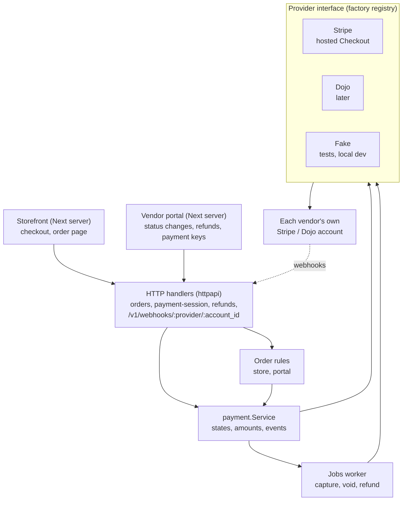
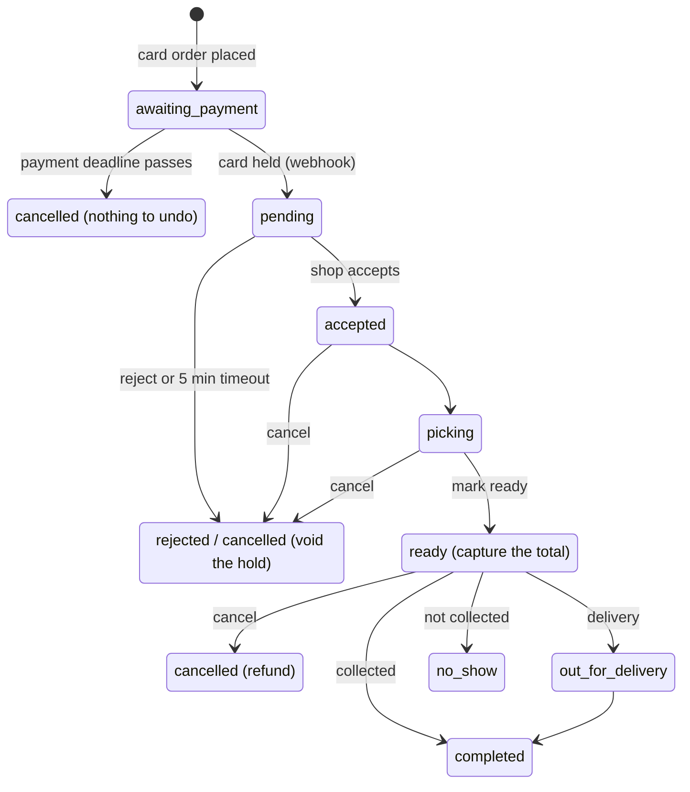

# Checkout & payments: implementation guide

Plan written 2026-10-20. The contract below is what the frontend gets built against, so update the frontend when changing it.

---

## Summary

Build a new `internal/payment` package around a small `Provider` interface, with Stripe as the first adapter and Dojo added later without touching orders. The checkout code calls a `payment.Service`, never Stripe directly. Each provider only translates calls to its own API and turns its webhooks into one shared event shape.

This follows the decision already in [`api.md`](api.md) (Customer side): **hold the total at checkout, capture the final amount at `ready`, release it on cancel.** Substitutions only lower the total, so a partial capture always covers the final amount.

Four decisions shape the rest of this guide:

- **Each vendor brings their own keys.** A vendor's owner pastes their own Stripe (later Dojo) secret key into the vendor portal. Money goes straight to the vendor's account, the vendor pays the provider's fees, and the platform never holds funds. We store the key encrypted, build a provider client per vendor for each call, and register a webhook in the vendor's account for them.
- **Hosted payment page first** (Stripe Checkout, later Dojo's hosted checkout). Card data never touches our servers or the Next app, and the frontend needs no Stripe SDK. Every provider fits one shape: "create a session, get a redirect URL".
- **Payment state lives in its own table**, not in `orders.status`. An order gets one new status, `awaiting_payment`, so the shop never sees an unpaid card order.
- **Capture, void and refund run through a job queue**, the same pattern as `notification_outbox`. A slow or failing provider never blocks a vendor's button press, and retries are safe.

## What we have today

Ordering works end to end, but no payment code, columns or config exist yet. The pieces a payment layer will plug into:

| Area             | What exists                                                                        | Where                                              | What payments needs from it                                        |
| ---------------- | ---------------------------------------------------------------------------------- | -------------------------------------------------- | ------------------------------------------------------------------ |
| Placing an order | `PlaceOrder`: idempotency key, server-side prices, `expected_total`, 422 issues    | `internal/store/service.go`                        | Every order starts as `awaiting_payment` with a `payment_deadline` |
| Order table      | `status`, `subtotal`, `delivery_fee`, `total` in pence, `accept_deadline`          | migrations `0007`, `0008`, `0011`                  | New status and a link to a `payments` row                          |
| Status rules     | `transitions` map, `ChangeOrderStatus`, row-locked `TransitionOrderStatus`         | `internal/portal/orders.go`                        | Queue a capture on `ready`, a void on `rejected` and `cancelled`   |
| Timeouts         | `ExpireOverdue` (5 min accept), `ExpireUncollected` (no-show), substitution expiry | `internal/store/service.go` `RunExpiry`            | One more job: expire unpaid `awaiting_payment` orders              |
| Substitutions    | `charged_total` per line; subtotal = sum of `charged_total`                        | `internal/store/substitutions.go`                  | The amount to capture at `ready`                                   |
| Background work  | `notification_outbox` with `FOR UPDATE SKIP LOCKED`                                | migration `0011`, `internal/notify`                | Copy the pattern for `payment_jobs`                                |
| Secrets at rest  | `crypto.SecretBox` (AES-256-GCM, `APP_ENCRYPTION_KEY`) for inventory system keys          | `internal/crypto/secret.go`, `httpapi/branches.go` | Encrypt vendors' provider keys and webhook secrets                 |
| Live updates     | Postgres trigger, `NOTIFY order_events`, SSE to customer and vendor                | `internal/events`, `httpapi/live.go`               | Payment changes touch `orders`, so screens update for free         |
| Checkout UI      | `/checkout` form, `placeOrder` server action, swipe to confirm                     | `frontend/app/(storefront)/checkout`               | Payment method choice, then a redirect                             |
| Order page       | `/orders/[id]` with countdown, SSE, `useLive`                                      | `frontend/components/order`                        | "Confirming payment" and "payment failed, try again" states        |

## Architecture

Use a **service with pluggable providers**, not a "payment controller" that knows every provider. HTTP handlers stay thin, `payment.Service` holds the rules (amounts, states, retries), and each provider is an adapter that only speaks its own API.



Only the adapters inside the provider box know about a provider. Everything above them works the same for Stripe, Dojo or the fake provider. All state lives in Postgres: `orders`, `payments`, `payment_events`, `payment_jobs`, `vendor_payment_accounts`.

### Package layout

```
backend/internal/payment/
  provider.go      // Provider + Connector interfaces, shared types (Session, Event, errors)
  registry.go      // map[name]Factory, filled in main.go from PAYMENT_PROVIDERS
  service.go       // StartCheckout, HandleEvent, Connect, QueueCapture/Void/Refund
  jobs.go          // payment_jobs worker (capture, void, refund, retries)
  stripe/stripe.go // Stripe adapter
  dojo/dojo.go     // later
  fake/fake.go     // in-memory provider for tests and local dev
backend/internal/httpapi/
  payments.go      // payment-session, vendor refunds, vendor payment settings
  webhooks.go      // POST /v1/webhooks/{provider}/{account_id}
```

### The interface

Keep it to what _every_ card provider can do. Anything provider-specific stays inside its adapter.

```go
package payment

type Provider interface {
    Name() string // "stripe", "dojo", "fake"

    // CreateSession starts a hosted payment page that authorises (holds)
    // the amount without capturing it.
    CreateSession(ctx context.Context, in SessionInput) (Session, error)

    // Capture takes up to the authorised amount; the rest is released.
    Capture(ctx context.Context, ref string, amount int64, idemKey string) error
    // Void releases an uncaptured hold.
    Void(ctx context.Context, ref string, idemKey string) error
    // Refund returns money from a captured payment.
    Refund(ctx context.Context, ref string, amount int64, idemKey string) (refundRef string, err error)

    // ParseWebhook checks the signature and maps the provider's event to ours.
    // ok = false for events we don't care about.
    ParseWebhook(r *http.Request, body []byte) (ev Event, ok bool, err error)
}

type SessionInput struct {
    PaymentID   uuid.UUID // our payments.id; also the idempotency key
    Amount      int64     // pence
    Currency    string    // "gbp"
    Reference   string    // TH-10234, shown on the card statement
    Email       string
    SuccessURL  string
    CancelURL   string
    ExpiresAt   time.Time
}

type Session struct {
    ProviderRef string // Stripe Checkout Session id, Dojo payment intent id
    RedirectURL string
}

type EventKind string

const (
    EventAuthorised EventKind = "authorised"
    EventFailed     EventKind = "failed"
    EventExpired    EventKind = "expired"
    EventCaptured   EventKind = "captured"
    EventVoided     EventKind = "voided"
    EventRefunded   EventKind = "refunded"
)

type Event struct {
    ID          string    // provider's event id, for dedupe
    Kind        EventKind
    PaymentID   uuid.UUID // ours, sent to the provider as metadata
    ProviderRef string    // which session/intent
    PaymentRef  string    // the charge reference Capture/Void/Refund need
    Amount      int64
    Raw         []byte
}
```

### Per-vendor credentials (bring your own keys)

There's no global provider. The registry holds a **factory** per provider name, and the service builds a provider from one vendor's decrypted keys for each call.

```go
// Credentials are decrypted from vendor_payment_accounts for one call.
type Credentials struct {
    AccountID     uuid.UUID // vendor_payment_accounts.id
    SecretKey     string
    WebhookSecret string
    Live          bool
}

// Factory builds a Provider for one vendor's keys. No network calls.
type Factory func(c Credentials) (Provider, error)

// Registry maps "stripe", "dojo", "fake" to their factory.
type Registry map[string]Factory

// Connector is what the vendor "connect" screen needs. Every
// bring-your-own-key provider implements it next to Provider.
type Connector interface {
    // VerifyCredentials makes one harmless read call to prove the key works.
    VerifyCredentials(ctx context.Context) (AccountInfo, error)
    // RegisterWebhook creates our endpoint in the vendor's account and
    // returns its signing secret.
    RegisterWebhook(ctx context.Context, url string) (webhookID, secret string, err error)
    DeleteWebhook(ctx context.Context, webhookID string) error
}

type AccountInfo struct {
    DisplayName string // business name from the provider, shown to the owner
    Live        bool   // live key or test key
}
```

- **Which account to use:** a new checkout uses the vendor's `active` account. Capture, void, refund and webhooks use the account stored on the payment row, even if the vendor has since changed keys.
- **Encryption:** reuse `crypto.SecretBox` and `APP_ENCRYPTION_KEY`, as branch inventory system keys already do (`httpapi/branches.go`). Decrypt only inside `payment.Service`, right before the call.
- **Never return a key.** Endpoints show the provider, test or live, and the last 4 characters.
- **Stripe gotcha:** never set the global `stripe.Key`. Create a client per call with the vendor's key, or one vendor's request could use another vendor's key under load.

### Rules for the service

- **Never call a provider inside a database transaction.** Write our row first, call the provider with our id as the idempotency key, then update the row. A crash in between is fixed by the retry or by the webhook.
- **Webhooks are the source of truth** for "paid". The customer coming back to the success URL only shows a "confirming" screen.
- **Each payment row points at the vendor payment account it was made with.** Switching a vendor from Stripe to Dojo, or to new keys, must not break capture or refund of orders already held.
- `payment.Service` depends on `store`/`portal` through small callbacks (e.g. `OnAuthorised(orderID)`), so `payment` doesn't import the order packages and there's no import cycle.

## Data model

One migration (`0012_payments.sql`) adds four tables and a `payment_deadline` column on orders. The SQL below is the original sketch: the migration file is the source of truth (it adds `branch_id`, `redirect_url`, `expires_at`, `failure_code` and more indexes to `payments`, and a lease-based job queue). Money stays in pence as `BIGINT`, like the rest of the schema.

```sql
-- +goose Up
ALTER TABLE orders
    ADD COLUMN payment_deadline TIMESTAMPTZ; -- when an unpaid order is dropped

-- Add 'awaiting_payment' to orders_status_check (drop + re-add the constraint).

-- Each vendor's own provider keys (bring your own).
CREATE TABLE vendor_payment_accounts (
    id                 UUID PRIMARY KEY DEFAULT gen_random_uuid(),
    vendor_id          UUID NOT NULL REFERENCES vendors(id),
    provider           TEXT NOT NULL,           -- 'stripe', 'dojo', 'fake'
    live               BOOLEAN NOT NULL,        -- live key or test key
    display_name       TEXT,                    -- business name from the provider
    secret_key_enc     BYTEA NOT NULL,          -- crypto.SecretBox
    secret_key_last4   TEXT NOT NULL,           -- shown instead of the key
    webhook_id         TEXT,                    -- our endpoint in their account
    webhook_secret_enc BYTEA,                   -- its signing secret, encrypted
    status             TEXT NOT NULL DEFAULT 'connecting'
        CHECK (status IN ('connecting', 'active', 'disabled', 'invalid')),
    last_error         TEXT,                    -- e.g. key revoked in Stripe
    created_by         UUID REFERENCES vendor_users(id) ON DELETE SET NULL,
    created_at         TIMESTAMPTZ NOT NULL DEFAULT now(),
    updated_at         TIMESTAMPTZ NOT NULL DEFAULT now()
);
-- One account takes new checkouts. Old rows stay, because held payments
-- still need their keys to capture, void or refund.
CREATE UNIQUE INDEX vendor_payment_accounts_one_active_idx
    ON vendor_payment_accounts (vendor_id) WHERE status = 'active';

-- One row per attempt. A failed or abandoned attempt stays; a retry makes a new row.
CREATE TABLE payments (
    id                 UUID PRIMARY KEY DEFAULT gen_random_uuid(),
    order_id           UUID NOT NULL REFERENCES orders(id) ON DELETE RESTRICT,
    provider           TEXT NOT NULL,            -- 'stripe', 'dojo', 'fake'
    payment_account_id UUID NOT NULL REFERENCES vendor_payment_accounts(id),
    provider_ref       TEXT,                     -- checkout session / payment intent
    payment_ref        TEXT,                     -- charge ref used for capture/void/refund
    status             TEXT NOT NULL DEFAULT 'created'
        CONSTRAINT payments_status_check CHECK (status IN (
            'created', 'authorised', 'failed', 'expired',
            'captured', 'voided', 'partially_refunded', 'refunded', 'capture_failed'
        )),
    currency           TEXT NOT NULL DEFAULT 'gbp',
    amount_authorised  BIGINT NOT NULL CHECK (amount_authorised >= 0),
    amount_captured    BIGINT NOT NULL DEFAULT 0 CHECK (amount_captured >= 0),
    amount_refunded    BIGINT NOT NULL DEFAULT 0 CHECK (amount_refunded >= 0),
    authorised_at      TIMESTAMPTZ,
    captured_at        TIMESTAMPTZ,
    created_at         TIMESTAMPTZ NOT NULL DEFAULT now(),
    updated_at         TIMESTAMPTZ NOT NULL DEFAULT now(),
    CHECK (amount_captured <= amount_authorised),
    CHECK (amount_refunded <= amount_captured)
);
CREATE UNIQUE INDEX payments_provider_ref_uidx ON payments (provider, provider_ref);
-- At most one live (held or paid) payment per order.
CREATE UNIQUE INDEX payments_one_live_idx ON payments (order_id)
    WHERE status IN ('authorised', 'captured', 'partially_refunded', 'capture_failed');

-- Every webhook we accept, for dedupe and debugging.
CREATE TABLE payment_events (
    provider     TEXT NOT NULL,
    event_id     TEXT NOT NULL,
    payment_id   UUID REFERENCES payments(id),
    kind         TEXT NOT NULL,
    payload      JSONB NOT NULL,
    received_at  TIMESTAMPTZ NOT NULL DEFAULT now(),
    PRIMARY KEY (provider, event_id)
);

-- Work for the provider, done by one worker (FOR UPDATE SKIP LOCKED).
CREATE TABLE payment_jobs (
    id              UUID PRIMARY KEY DEFAULT gen_random_uuid(),
    payment_id      UUID NOT NULL REFERENCES payments(id),
    kind            TEXT NOT NULL CHECK (kind IN ('capture', 'void', 'refund')),
    amount          BIGINT,          -- capture and refund
    reason          TEXT,            -- refund
    requested_by    UUID REFERENCES vendor_users(id) ON DELETE SET NULL,
    status          TEXT NOT NULL DEFAULT 'queued' CHECK (status IN ('queued', 'done', 'failed')),
    attempts        INT NOT NULL DEFAULT 0,
    next_attempt_at TIMESTAMPTZ NOT NULL DEFAULT now(),
    last_error      TEXT,
    created_at      TIMESTAMPTZ NOT NULL DEFAULT now()
);
CREATE INDEX payment_jobs_due_idx ON payment_jobs (next_attempt_at) WHERE status = 'queued';
```

Notes:

- **Idempotency key** for every provider call is `payments.id` (session) or `payment_jobs.id` (capture, void, refund). A retried job sends the same key, so the provider never charges twice.
- **Order history**: write an `order_status_events` row for payment milestones. Add `'payment'` to the `kind` check so the vendor timeline shows "Card held £24.50", "Captured £22.10", "Refunded £5.00".
- **Notifications**: the trigger already queues `status_<status>` emails. Make sure no email goes out for `awaiting_payment`, and add a `payment_failed` kind if you want to nudge the customer.
- **Changing or removing keys:** connecting new keys sets the old row to `disabled`. A `disabled` row takes no new checkouts but still captures, voids and refunds its own payments. Only delete its webhook once none of its payments are `authorised` or `capture_failed`. If a call fails with an authentication error (the vendor revoked the key), mark the row `invalid`, hide card at checkout, and show the owner a "reconnect" warning.

## Order and payment lifecycle

A card order only reaches the shop once the card is held. From then on it follows today's statuses unchanged, and payment work hangs off the transitions that already exist.



| When                                      | Order status                                                    | Payment action                                                  | Payment status after              |
| ----------------------------------------- | --------------------------------------------------------------- | --------------------------------------------------------------- | --------------------------------- |
| Customer places a card order              | `awaiting_payment` (new), `payment_deadline` = now + 30 min     | Create `payments` row, then provider session                    | `created`                         |
| Webhook: card held                        | `awaiting_payment` → `pending`, `accept_deadline` = now + 5 min | Record amount and `payment_ref`                                 | `authorised`                      |
| Webhook: failed, or session expired       | stays `awaiting_payment`                                        | Customer can retry: a new `payments` row and session            | `failed` / `expired`              |
| `payment_deadline` passes, still unpaid   | `cancelled`, reason `payment_not_completed`                     | None                                                            | unchanged                         |
| Shop rejects, or the 5 min accept timeout | `rejected` / `cancelled`                                        | Queue `void`                                                    | `voided`                          |
| Shop cancels from `accepted` or `picking` | `cancelled`                                                     | Queue `void`                                                    | `voided`                          |
| Shop marks `ready`                        | `ready`                                                         | Queue `capture` for the current `total` (after substitutions)   | `captured`                        |
| Collected, or no-show                     | `completed` / `no_show`                                         | None: already captured; no refund on no-show per terms          | `captured`                        |
| Cancel after `ready`                      | `cancelled`                                                     | Queue `refund` of the captured amount                           | `refunded`                        |
| Vendor refunds part of an order           | unchanged                                                       | Queue `refund` (owner/manager only)                             | `partially_refunded` / `refunded` |
| Capture fails (hold expired, card closed) | `ready` stays                                                   | Mark `capture_failed`; vendor sees "take payment at collection" | `capture_failed`                  |

Two things to handle on purpose:

- **Holds expire.** A Stripe card hold lasts about 7 days. Collection is same-day, so that's fine. Delivery can be booked up to ~14 days ahead, so for a delivery more than 5 days away, **capture when the shop accepts** and refund any substitution difference at `ready`. Alternative: only allow card payment for deliveries within 5 days.
- **Webhook before the customer returns, or never.** The order page polls/streams `GET /orders/{id}`, so it shows "Confirming payment" until the webhook flips the order to `pending`. Add a small reconcile job: for `created` payments older than 10 minutes, ask the provider for the session status, in case a webhook was lost.

The vendor's `transitions` map stays as it is. `awaiting_payment` is not in it, because only the payment service moves an order out of that status. Hide `awaiting_payment` orders from the vendor queue and the vendor SSE feed. In "My orders", show them as "Payment not finished" with a link back to the order.

## API contract

Same conventions as the rest of [`api.md`](api.md): storefront key for `/v1/store/*`, snake_case, pence, 422 with `issues`.

### Storefront

```
GET /v1/store/branch
  + "payments": { "enabled": true }
    (false when the vendor has no active payment account: checkout is
     closed, because card is the only way to pay)

POST /v1/store/orders
  → 201 with "status": "awaiting_payment"; no accept countdown yet
  503 when the vendor has no active account

POST /v1/store/orders/{id}/payment-session
  { "success_url": "https://shop.../orders/{id}?payment=return",
    "cancel_url":  "https://shop.../orders/{id}?payment=cancelled" }
  → 201 { "redirect_url": "https://checkout.stripe.com/...", "expires_at": "..." }
  409 when the order isn't awaiting_payment (already paid, cancelled),
      the payment window closed, or another request is creating the session
  Calling it again while a session is open returns the same session

GET /v1/store/orders/{id}   (and the SSE event body)
  + "payment_deadline": "..." | null
  + "payment": {
      "status": "created" | "authorised" | "failed" | "expired" | "captured"
              | "voided" | "partially_refunded" | "refunded" | "capture_failed",
      "amount_authorised": 2450, "amount_captured": 2210, "amount_refunded": 0
    } | null

GET /v1/store/me/orders
  needs_action = true while awaiting_payment
```

The Next server builds `success_url` and `cancel_url` from the request host, so the API never needs to know the storefront's URL. Order creation and the payment session are split so a customer whose card failed can retry without placing a new order.

### Webhooks

```
POST /v1/webhooks/{provider}/{account_id}   e.g. /v1/webhooks/stripe/6f1c…
  No storefront key. account_id picks the vendor's webhook secret;
  unknown account, or provider doesn't match → 404.
  Signature checked by the provider adapter on the raw body.
  → 200 once stored (also for duplicates and events we ignore)
  → 400 bad signature
  → 500 only when our database fails, so the provider retries
```

This is the only route a third party calls, so it must be reachable from the internet. Either expose just `/v1/webhooks/*` from the API, or relay it through a Next route handler that forwards the raw body and signature header untouched.

### Vendor

```
GET  /v1/vendor/branches/{id}/orders  and  …/orders/{orderId}
  + "payment" (same shape as the storefront)
  orders in awaiting_payment are never listed

POST /v1/vendor/branches/{id}/orders/{orderId}/refunds    (owner, manager)
  { "amount": 500, "reason": "Damaged item" }
  → 202 order detail (refund queued)
  422 field amount when amount > captured - refunded
  409 when the payment isn't captured yet (cancel the order instead)

GET    /v1/vendor/payments            (owner, manager)
  → { "provider": "stripe", "live": true, "display_name": "Grocery Shop Ltd",
      "key_last4": "x9Qa", "status": "active" | "invalid",
      "last_error": null, "connected_at": "..." } | null

PUT    /v1/vendor/payments            (owner only, new ManagePayments permission)
  { "provider": "stripe", "secret_key": "rk_live_..." }
  → 200 the account as above
  Steps: verify the key → register our webhook in their account →
         encrypt and store → set the previous account to disabled
  422 field secret_key: "Stripe rejected this key" |
      "This key can't create checkout sessions" (missing permission)
  422 field provider: not one of the enabled providers

DELETE /v1/vendor/payments            (owner only)
  → 204; card checkout turns off, payments already held still finish
```

### Admin

```
GET  /v1/admin/vendors/{id}/payments   → same shape as the vendor GET, read-only
  Admins never see or set keys. An invalid account shows on the
  overview's "needs attention" list.
```

### Config (`backend/.env`)

- `PAYMENT_PROVIDERS=stripe`: which providers vendors may choose (`fake` locally)
- `PUBLIC_WEBHOOK_BASE_URL`: the public address webhook URLs are built from
- `PAYMENT_WINDOW_MINUTES` (30), `PAYMENT_CAPTURE_EARLY_DAYS` (5)
- `STRIPE_DEV_WEBHOOK_SECRET`: development only, overrides stored secrets so `stripe listen` works

No provider keys live in `.env`; they belong to each vendor.

## Stripe implementation

Use **Stripe Checkout** (hosted page) with a manually captured PaymentIntent, via the official `github.com/stripe/stripe-go` library. Check the current major version and the event names against Stripe's docs when you start; the mapping below is the shape to aim for.

### Interface method to Stripe call

| Our method      | Stripe call                                              | Key settings                                                                                                                                                                                                                                                                           |
| --------------- | -------------------------------------------------------- | -------------------------------------------------------------------------------------------------------------------------------------------------------------------------------------------------------------------------------------------------------------------------------------- |
| `CreateSession` | Create Checkout Session                                  | `mode=payment`, one line item "Order TH-10234" for the total, `payment_intent_data.capture_method=manual`, `metadata.payment_id` on the session **and** `payment_intent_data.metadata`, `customer_email`, `expires_at` (Stripe allows 30 min to 24 h), idempotency key = `payments.id` |
| `Capture`       | Capture PaymentIntent                                    | `amount_to_capture` = order total after substitutions; the rest is released automatically                                                                                                                                                                                              |
| `Void`          | Cancel PaymentIntent                                     | Only while uncaptured                                                                                                                                                                                                                                                                  |
| `Refund`        | Create Refund                                            | `payment_intent`, `amount`, idempotency key = `payment_jobs.id`                                                                                                                                                                                                                        |
| `ParseWebhook`  | `webhook.ConstructEvent(body, Stripe-Signature, secret)` | Read the raw body before any JSON decoding                                                                                                                                                                                                                                             |

### Webhook events to map

| Stripe event                               | Our `EventKind`              | Notes                                                                |
| ------------------------------------------ | ---------------------------- | -------------------------------------------------------------------- |
| `checkout.session.completed`               | (store the PaymentIntent id) | Fills `payment_ref`; with manual capture the money is held, not paid |
| `payment_intent.amount_capturable_updated` | `authorised`                 | The hold is in place: move the order to `pending`                    |
| `payment_intent.payment_failed`            | `failed`                     |                                                                      |
| `checkout.session.expired`                 | `expired`                    |                                                                      |
| `payment_intent.canceled`                  | `voided`                     | Confirms our void, or Stripe dropping an expired hold                |
| `payment_intent.succeeded`                 | `captured`                   | Confirms our capture                                                 |
| `charge.refunded`                          | `refunded`                   | Amount comes from the charge                                         |

Everything else returns 200 and is ignored. Use one line item for the whole order, not one per product: the amount is what matters, and substitutions change lines after payment anyway.

### Handling a webhook

1. Load the account from `{account_id}`, decrypt its webhook secret, read the raw body, call `ParseWebhook`. Bad signature → 400.
2. `INSERT INTO payment_events … ON CONFLICT DO NOTHING`. Already there → 200, stop.
3. In one transaction: lock the `payments` row (`FOR UPDATE`), apply the event only if it moves the status forward, and update the order (e.g. `awaiting_payment` → `pending` with a fresh `accept_deadline`).
4. If the order was already cancelled when `authorised` arrives (customer paid after the deadline), queue a `void` straight away.
5. Return 200.

### Connecting a vendor's Stripe account

What `PUT /v1/vendor/payments` does for Stripe:

1. Check the key's shape: `sk_` or `rk_`, then `live` or `test`. In production, refuse test keys unless the vendor is flagged as a demo.
2. `VerifyCredentials`: one harmless read call, such as retrieving the balance. A 401 becomes the 422 "Stripe rejected this key".
3. Insert the account row as `connecting`, so its id exists for the webhook URL.
4. `RegisterWebhook`: create a webhook endpoint at `{PUBLIC_WEBHOOK_BASE_URL}/v1/webhooks/stripe/{account_id}` for just the events in the table above. Stripe returns the signing secret **only in this response**, so encrypt and store it straight away.
5. In one transaction: set this row `active`, the previous one `disabled`.
6. If any step fails, delete the webhook you made and mark the row `invalid`, so a half-connected account never takes payments.

Ask vendors for a **restricted key** (`rk_...`) rather than their full secret key. It needs write access to Checkout Sessions, PaymentIntents, Refunds and Webhook Endpoints. The vendor portal screen should list exactly these, with a link to Stripe's API keys page. Check the exact permission names in Stripe's dashboard when you build it.

### Local testing

- Connect a vendor in the portal with a Stripe **test** key (`sk_test_...` or `rk_test_...`). Its webhook can't reach localhost, so run `stripe listen --forward-to localhost:8080/v1/webhooks/stripe/<account_id>` and put the secret it prints in `STRIPE_DEV_WEBHOOK_SECRET`.
- Test cards: `4242 4242 4242 4242` (works), `4000 0025 0000 3155` (asks for 3-D Secure), `4000 0000 0000 9995` (declined).
- `stripe trigger payment_intent.payment_failed` for the failure paths.
- The `fake` provider returns a redirect to a local "Pay / Fail" page and posts its own webhooks. Use it for integration tests so they never call Stripe.

## Adding Dojo or other providers later

A new provider is one new adapter package and one factory in the registry; vendors then pick it and paste their own key. Orders, jobs, webhooks and the frontend stay unchanged. That only holds if the provider can do the five things in the interface: hosted page, hold, partial capture, void and refund.

To add one:

1. Check it supports **manual capture with a partial amount**. If not, the adapter captures straight away and refunds the difference at `ready`. Hide that inside the adapter, or let the service ask through an optional `Capabilities()` method.
2. Write `internal/payment/<name>/<name>.go` implementing `Provider`, including webhook signature checks.
3. Map its events to our six `EventKind`s. Put our `payments.id` in its metadata or reference field so events find their row.
4. Implement `Connector` too: verify a key, and register or delete a webhook in the vendor's account. If the provider can't register webhooks through its API, return the URL and secret steps for the vendor to paste into its dashboard.
5. Register its factory in `main.go` and add it to `PAYMENT_PROVIDERS`. Run the same integration tests as the `fake` provider against its sandbox.

Dojo has a payment-intent API with a hosted checkout page and its own webhooks, so it should fit this shape. Its manual capture and partial capture rules weren't checked for this guide: confirm them in Dojo's API docs before building.

Avoid adding methods to `Provider` for one provider's extras (saved cards, Apple Pay settings). Put those in the adapter's own config or an optional extra interface checked with a type assertion.

## Frontend work

Built against the contract above, with mock data until the endpoints are live. No Stripe JS SDK is needed, because the hosted page handles the card.

| Where                              | Change                                                                                                                                                                                                                                    |
| ---------------------------------- | ----------------------------------------------------------------------------------------------------------------------------------------------------------------------------------------------------------------------------------------- |
| `components/checkout/`             | The button reads "Continue to payment"; checkout shows "This shop isn't taking online orders right now" when `branch.payments.enabled` is false                                                                                           |
| `checkout/actions.ts` `placeOrder` | Call `payment-session` with URLs built from the request host, then `redirect()` to `redirect_url`. Keep the cart until payment succeeds                                                                                                   |
| `/orders/[id]`                     | States for `awaiting_payment`: "Confirming payment" after `?payment=return`; "Payment not finished" with "Try again" (new session) after `?payment=cancelled` or a failure; the `payment_deadline` countdown via the existing `Countdown` |
| `components/order/PriceBreakdown`  | "Card held £24.50", then "Charged £22.10", plus refunds                                                                                                                                                                                   |
| `/account` "My orders"             | "Payment not finished" badge                                                                                                                                                                                                              |
| Vendor order list and detail       | Payment status badge; `capture_failed` warning "Take payment at collection"; payment lines in history                                                                                                                                     |
| Vendor `RefundDialog`              | Amount (money input helpers), reason; owners and managers only                                                                                                                                                                            |
| Vendor "Payments" settings page    | Owners pick a provider and paste a key, with the permission list and a link to the provider's keys page. Shows business name, test or live, last 4 and status, plus reconnect and disconnect. Admin vendor detail gets a read-only status |
| `lib/order-status.ts`              | Label and colour for `awaiting_payment`                                                                                                                                                                                                   |

The cart is cleared today when the order is placed. For card orders it'll be cleared when the order page first sees `pending`, so a customer who backs out of the payment page still has their cart.

## TODO checklist

Work top to bottom. Each phase ends with something you can test, and the `fake` provider means Stripe isn't needed until phase 4. **B** = backend, **F** = frontend.

### Phase 1: foundations (no provider yet)

- [x] B1 Migration `0012_payments.sql`: `payment_deadline`, `awaiting_payment` status, `vendor_payment_accounts`, `payments`, `payment_events`, `payment_jobs`, `'payment'` history kind
- [x] B2 sqlc queries: insert/get/lock payment, record event, enqueue/claim/finish job, get active/by-id vendor payment account; `make sqlc`
- [x] B3 `internal/payment`: `Provider`, `Connector`, types, factory registry, the `fake` provider
- [x] B4 Keep `awaiting_payment` out of the vendor list, vendor SSE, expiry of `pending` orders, and status emails
- [x] B5 Unit tests for the state rules (which event moves which status)

### Phase 2: taking a card hold

- [x] B6 `PlaceOrder`: refuse when the branch has no active payment account; insert as `awaiting_payment` with `payment_deadline` (add both to `InsertOrder`), no accept countdown
- [x] B7 `POST /orders/{id}/payment-session` → `payment.Service.StartCheckout`
- [x] B8 `POST /v1/webhooks/{provider}/{account_id}`: raw body, dedupe, lock, apply; `authorised` → order `pending` with a fresh `accept_deadline`. Plus the fake provider's Pay / Decline page at `/fake-pay/{ref}`
- [x] B9 Job: cancel unpaid orders after `payment_deadline` (reason `payment_not_completed`)
- [x] B10 `payment` block on store order responses and vendor order detail (vendor list badges come with F4); `payments.enabled` on `/store/branch`
- [x] F1 Types and API client additions
- [x] F2 Redirect from `placeOrder` to the payment page, keep the cart until paid (no method picker: card only)
- [x] F3 Order page payment states and "Try again"

### Phase 3: capture, void, refund

- [ ] B11 `payment_jobs` worker (claim with `SKIP LOCKED`, backoff, `last_error`), started next to the outbox worker
- [ ] B12 Hook `ChangeOrderStatus`, `RejectOrder`, `ExpireOverdue`: queue `capture` at `ready`, `void` on reject/cancel, `refund` on cancel after `ready`, in the same transaction as the status change
- [ ] B13 Early capture for deliveries more than `PAYMENT_CAPTURE_EARLY_DAYS` away (capture at accept, refund the difference at `ready`)
- [ ] B14 `capture_failed` handling and the vendor warning flag
- [ ] B15 `POST …/orders/{orderId}/refunds` (owner, manager), with history entry
- [ ] F4 Vendor payment badges, `capture_failed` warning, `RefundDialog`, history lines
- [ ] F5 Price breakdown: held, charged, refunded

### Phase 4: Stripe

- [ ] B16 `internal/payment/stripe` adapter with a client per vendor key (table in "Stripe implementation")
- [ ] B17 Stripe `Connector`: verify key, register and delete webhook
- [ ] B18 `GET/PUT/DELETE /v1/vendor/payments`, `ManagePayments` permission for owners, key encryption with `crypto.SecretBox`
- [ ] B19 Mark an account `invalid` on auth errors; hide card at checkout while it is
- [ ] B20 Reconcile job for sessions stuck in `created` for 10+ minutes
- [ ] B21 Admin read-only `GET /v1/admin/vendors/{id}/payments` and the "needs attention" item
- [ ] F6 Vendor Payments settings page; admin read-only status
- [ ] B22 End-to-end with a test key, `stripe listen` and the test cards: connect, pay, fail, 3-D Secure, abandon, reject, substitute then capture, refund, change keys while a payment is held

### Phase 5: going live

- [ ] B23 Expose only `/v1/webhooks/*` publicly (or the Next relay) and set `PUBLIC_WEBHOOK_BASE_URL`
- [ ] B24 Update terms (`TERMS_VERSION`): the shop, not the platform, takes the payment; card holds, captures and refunds
- [ ] F7 Docs: contract in `api.md`, README roadmap
- [ ] B25 Alerts for failed `payment_jobs`, `capture_failed` and `invalid` accounts (fits the logging work in README "Later")

### Later

- [ ] Dojo adapter and `Connector` (see "Adding Dojo")
- [ ] "Connect with Stripe" sign-in instead of pasting a key, if pasting keys proves hard for vendors
- [ ] Apple Pay / Google Pay (both come with Stripe Checkout once the vendor enables them in their dashboard)

## Open questions

These change the build, so they're worth settling before phase 1.

- [x] **Whose account takes the money?** Decided: each vendor brings their own Stripe or Dojo key, so every shop is the merchant of record and pays its own card fees. Platform fees from README "Later" will need separate billing, since there's no Connect fee to take a cut from.
- [ ] **Per vendor or per branch?** One account per vendor is assumed, matching customer accounts. Branches that are separate companies would need an account each.
- [ ] **Who can connect keys:** owner only (assumed), or managers too.
- [ ] **Test keys in production:** refuse them, or allow them for demo vendors only.
- [x] **Keep "pay in store"?** Decided 2026-10-21: no. Online orders are paid online, by card only. There's no `payment_method` column; orders placed before payments have no `payments` row.
- [x] **Vendors without their own Stripe/Dojo (later):** the platform will offer its own account for a higher monthly subscription. Fits as another kind of `vendor_payment_accounts` row (e.g. `managed_by = 'platform'` plus the provider's connected-account id, with `secret_key_enc` nullable for those rows), added in a later migration. Payments point at the account row, so orders, jobs and webhooks don't change.
- [ ] **Deliveries far ahead:** capture at accept (recommended), or only offer card for deliveries within 5 days.
- [ ] **Payment window:** 30 minutes to finish paying before the order is dropped. Shorter is fine for same-day collection.
- [ ] **Who can refund:** owner and manager only (assumed), or staff too.
- [ ] **Card fees on refunds and no-shows:** Stripe keeps its fee on a refund. Is that the shop's cost, and do the terms need to say so?
